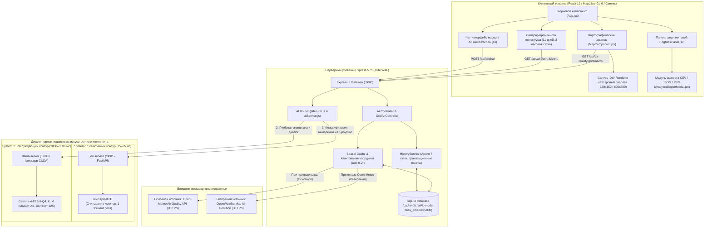

# 🌍 AeroCast

<div align="center">


**Геоинформационная веб-платформа экологического мониторинга, предиктивного анализа и визуализации качества атмосферного воздуха на 11 дней с двухконтурным локальным искусственным интеллектом (System 1 + System 2)**

[](file:///c:/Users/Administrator/Documents/GitHub/aerocast/frontend/package.json)
[](file:///c:/Users/Administrator/Documents/GitHub/aerocast/frontend/src/components/MapComponent.jsx)
[](file:///c:/Users/Administrator/Documents/GitHub/aerocast/server/package.json)
[-003b57?style=flat-square&logo=sqlite)](file:///c:/Users/Administrator/Documents/GitHub/aerocast/server/config/db.js)
[-success?style=flat-square&logo=jest)](file:///c:/Users/Administrator/Documents/GitHub/aerocast/server/tests)
[-brightgreen?style=flat-square)](file:///c:/Users/Administrator/Documents/GitHub/aerocast/server/tests)
[](file:///c:/Users/Administrator/Documents/GitHub/aerocast/server/ai)
[](file:///c:/Users/Administrator/Documents/GitHub/aerocast/README.md#-%D0%BB%D0%B8%D1%86%D0%B5%D0%BD%D0%B7%D0%B8%D1%8F)

[Быстрый старт](#-быстрый-старт) • [Руководство пользователя](#-руководство-пользователя) • [Архитектура и модули](#-архитектура-системы-и-правила-работы-с-модулями) • [API Справочник](#-справочник-rest-api) • [Тестирование (TDD)](#-тестирование-и-методология-tdd)

</div>

---

## 📋 Оглавление

1. [🌟 О проекте и концепция](#-о-проекте-и-концепция)
2. [🛠 Технологический стек](#-технологический-стек)
3. [📁 Структура репозитория](#-структура-репозитория)
4. [⚡ Быстрый старт](#-быстрый-старт)
   - [Способ 1: AeroCast Control Manager (Рекомендуемый)](#способ-1-aerocast-control-manager-рекомендуемый)
   - [Способ 2: Запуск в Docker Compose (Full Stack с GPU/CPU)](#способ-2-полный-стек-в-docker-compose)
   - [Способ 3: Локальная веб-разработка без нейросетей (Safe Fallback)](#способ-3-локальная-веб-разработка-без-нейросетей)
5. [🖥️ Руководство пользователя](#-руководство-пользователя)
6. [📐 Архитектура системы и правила работы с модулями](#-архитектура-системы-и-правила-работы-с-модулями)
   - [6.1. 🧠 Модуль двухконтурного ИИ (System 1 + System 2)](#61--модуль-двухконтурного-ии-dual-circuit-ai-system-1--system-2)
   - [6.2. 📊 Модуль аналитики и временных рядов (11-дневный континуум)](#62--модуль-аналитики-и-временных-рядов-analytics--time-continuum)
   - [6.3. 🌐 Модуль API внешних источников и отказоустойчивости (Fallback Pipeline)](#63--модуль-api-внешних-источников-и-отказоустойчивости-fallback-pipeline)
   - [6.4. 🧮 Модуль калькуляторов качества воздуха (AQI & EAQI Calculators)](#64--модуль-калькуляторов-качества-воздуха-aqi--eaqi-calculators)
   - [6.5. 🗺️ Картографический модуль и IDW-интерполяция (MapLibre GL & Canvas)](#65-️-картографический-модуль-и-idw-интерполяция-maplibre-gl--spatial-engine)
7. [⚙️ Конфигурация окружения (`server/.env`)](#️-конфигурация-окружения-serverenv)
8. [🗄️ База данных и кэширование (SQLite WAL)](#️-база-данных-и-кэширование-sqlite-wal)
9. [🔌 Справочник REST API](#-справочник-rest-api)
10. [🧪 Тестирование и методология TDD](#-тестирование-и-методология-tdd)
11. [🛠️ Диагностика и устранение неполадок (FAQ)](#️-диагностика-и-устранение-неполадок-troubleshooting--faq)
12. [👥 Авторство, команда разработки и лицензия](#-авторство-команда-разработки-и-лицензия)

---

## 🌟 О проекте и концепция

**AeroCast** — открытая научно-практическая геоинформационная веб-платформа непрерывного мониторинга, картографической визуализации и предиктивного анализа химического состава атмосферного воздуха на территории Российской Федерации и сопредельных регионов.

### Ключевые возможности:
- **11-дневный временной континуум:** бесшовное слияние 7-дневного ретроспективного архива фактических почасовых замеров, данных текущего часа и 3-дневного предиктивного прогноза.
- **Двухконтурный локальный ИИ (Dual-Circuit AI):**
  - **System 1 (Jev-Style-0.8B):** сверхбыстрое (15–35 мс на GPU CUDA) считывание вердиктов из логитов трансформера без авторегрессии. Управляет темами оформления, слоями карты, палитрами доступности и надежно отсекает оффтоп/инъекции промптов.
  - **System 2 (Gemma-4-E2B-it-Q4_K_M):** генеративная нейросеть в образе маскота **Аи** (цундере-маскот чистого воздуха). Проводит глубокий метеорологический анализ 11 дней, формирует персонализированные медицинские советы и выполняет контекстную навигацию по городам.
- **Картографический движок MapLibre GL 6 (WebGL):** аппаратный рендеринг векторных и растровых карт (OpenStreetMap и ESRI Satellite) с наложением растрового поля интерполяции концентраций методом обратно взвешенных расстояний (IDW) и маскированием строго по полигонам государственной границы РФ 2026 года с непрерывным отображением Чукотки через 180° антимеридиан.
- **Инклюзивность и доступность:** Светлая/Тёмная темы, 4 палитры для людей с нарушениями цветовосприятия (*Okabe-Ito, Дейтеранопия, Протанопия, Тританопия*), распознавание речи (STT Web Speech API / Whisper) и озвучивание ответов (TTS).
- **Экспорт аналитики:** выгрузка данных в CSV (с кодировкой UTF-8 BOM для Microsoft Excel), структурированный JSON со сводной статистикой и генерация PNG-графиков динамики высокого разрешения.
- **Надежность и качество:** разработано строго по **TDD** с покрытием кода свыше **95%** (на бэкенде: 99.6% statements, 99.9% lines) и полным набором из **1 704 автоматизированных тестов** (100% PASS).

**Разработка:** команда студентов факультета информатики, математики и экономики КГПИ КемГУ (г. Новокузнецк) под руководством **Николаева Артёма Дмитриевича** (автор проекта, ведущий Fullstack-разработчик и архитектор).

---

## 🛠 Технологический стек

| Область | Технологии | Назначение |
|---|---|---|
| **Frontend** | **React 19** (`19.2.8`), **Vite 8** (`8.2.2`) | Современное SPA, React Fast Refresh, высокая отзывчивость |
| **Картография** | **MapLibre GL 6** (`6.10.0`), **HTML5 Canvas** | WebGL-рендеринг, тайлы OSM/ESRI, динамический растровый оверлей IDW |
| **Маскот и анимация** | **PixiJS 7.4**, **pixi-live2d-display**, Cubism 4 | Интерактивный анимированный персонаж Ая с эмоциональными состояниями |
| **Backend** | **Node.js 20+**, **Express 5** (`5.2.1`), **Axios** | Высокопроизводительный REST API шлюз, CORS, Graceful Shutdown |
| **База данных** | **SQLite 3** (`sqlite3 6.0.1` + `sqlite 5.1.1`) | Кэш внешних API, журнал замеров WAL, транзакционные пакетные вставки |
| **System 1 AI** | **Jev-Style-0.8B-Decision-v3** (C++ libllama + FastAPI) | Считывание логитов за 15–35 мс, Guardrails, переключение UI |
| **System 2 AI** | **Gemma-4-E2B-it-Q4_K_M** (`llama-server` CUDA) | Локальная рассуждающая LLM, метеоаналитика, маскот Ая |
| **Внешние API** | **Open-Meteo Air Quality** + **OpenWeatherMap** | Основной и резервный каскад источников метеоданных |
| **Тестирование** | **Vitest 5**, **Jest 30**, **Supertest 7**, **E2E Eval Suite** | 1 704 теста (932 фронтенд, 517 бэкенд, 255 сквозных E2E сценариев ИИ) |
| **Инфраструктура** | **Docker**, **Docker Compose**, PowerShell / Bash CLI | Контейнеризация и оркестрация стека, GPU passthrough (CDI/CUDA) |

---

## 📁 Структура репозитория

```
aerocast/
├── frontend/                               # Клиентское React-приложение (Vite)
│   ├── public/                             # Статические ассеты (favicon, иконки)
│   ├── src/
│   │   ├── assets/                         # Графика, иконки, эмоции маскота Аи
│   │   ├── components/
│   │   │   ├── AboutModal.jsx              # Окно «О проекте»: шкала EAQI, газы, ПДК, источники
│   │   │   ├── AnalyticsExportModal.jsx    # Модальное окно экспорта в CSV, JSON и PNG
│   │   │   ├── CitySearch.jsx              # Поиск городов с геокодированием и дебаунсом
│   │   │   ├── DynamicsChart.jsx           # График динамики концентраций с интерактивным выбором точек
│   │   │   ├── LayerSwitcher.jsx           # Переключатель подложек (OSM / Спутник ESRI)
│   │   │   ├── MapComponent.jsx            # Ядро карты MapLibre GL, маркеры и IDW-оверлей
│   │   │   ├── PollutionDynamicsModal.jsx  # Модалка 11-дневной динамики, экстремумы и выбор веществ
│   │   │   ├── RightAirPanel.jsx           # Панель химического состава, текущий EAQI, карточки газов
│   │   │   ├── SettingsModal.jsx           # Настройки темы (Dark/Light) и палитр цветовой слепоты
│   │   │   ├── Sidebar.jsx                 # Сайдбар: 11 дней, 3-часовые интервалы, часы, геолокация
│   │   │   └── AiChat/
│   │   │       ├── AiChatModal.jsx         # Окно диалога с Аей, голосовой ввод, ролевые команды
│   │   │       └── AyaMascot.jsx           # Интерактивный Live2D/Canvas маскот чистого воздуха
│   │   ├── hooks/                          # Пользовательские хуки (useAirGrid.js)
│   │   ├── styles/                         # Стили компонентов, глобальные CSS переменные и темы
│   │   ├── utils/
│   │   │   ├── canvasFieldRenderer.js      # Отрисовка цветового градиента поля на Canvas
│   │   │   ├── exportUtils.js              # Форматирование и выгрузка CSV (BOM), JSON и рендер PNG
│   │   │   ├── idwInterpolator.js          # Быстрая IDW-интерполяция сетки качества воздуха
│   │   │   ├── pollutantsInfo.js           # Описание, формулы, источники и ПДК 6 загрязнителей
│   │   │   ├── russiaBoundary2026.js       # Ray-Casting маска границы РФ 2026 года (антимеридиан 180°)
│   │   │   └── timeUtils.js                # Синхронизация времени ISO-8601 (Europe/Moscow)
│   │   ├── App.jsx                         # Корневой координатор состояния и окон
│   │   └── types.js                        # Шкала EAQI, градации уровней, палитры цветовой слепоты
│   ├── tests/                              # 40 тестовых сьютов Vitest (932 теста, 100% PASS)
│   ├── vite.config.js
│   └── package.json
│
├── server/                                 # Серверный шлюз (Node.js + Express 5 + SQLite)
│   ├── ai/                                 # Модуль двухконтурного искусственного интеллекта
│   │   ├── config/                         # aiConfig.js (Gemma 4), jevConfig.js (Jev-Style)
│   │   ├── controllers/                    # aiController.js (обработка чата, Whisper, статус)
│   │   ├── routes/                         # aiRoutes.js (/api/ai/chat, /transcribe, /status)
│   │   ├── schemas/                        # decisionSchemas.js (5 декларативных схем решений Jev)
│   │   ├── services/
│   │   │   ├── aiRouter.js                 # Маршрутизация запросов между System 1 и System 2
│   │   │   ├── aiService.js                # Интеграция с llama-server, постобработка, fallback
│   │   │   ├── jevClient.js                # HTTP-клиент к микросервису jev-service (FastAPI)
│   │   │   └── promptManager.js            # Ролевой промпт Аи, системный контекст, метеоанализ
│   │   └── tests/                          # E2E Evaluation Suite (255 сценариев: Jev + Gemma)
│   ├── config/                             # db.js (SQLite WAL, индексы, миграции)
│   ├── controllers/                        # airController.js, gridAirController.js, searchController.js
│   ├── routes/                             # api.js (маршруты /api/air, /api/search, /api/locate-me)
│   ├── services/
│   │   ├── aqiCalculator.js                # Расчет интегрального европейского индекса EAQI
│   │   ├── backupAirService.js             # Резервный источник OpenWeatherMap Air Pollution
│   │   ├── batchAirService.js              # Пакетное получение замеров для координатных сеток
│   │   ├── cacheService.js                 # Кэширование ответов внешних API в SQLite (TTL)
│   │   ├── geocodingService.js             # Геокодирование городов через Open-Meteo
│   │   ├── historyService.js               # Управление 7-дневным архивом и слияние со свежими замерами
│   │   ├── primaryAirService.js            # Основной источник данных Open-Meteo
│   │   ├── spatialCacheService.js          # Квантование координат (0.2°) и spatial-кэш сеток
│   │   ├── timeUtils.js                    # Валидация и форматирование меток времени
│   │   └── macroGridPoints550.json         # Координаты 550 опорных точек макро-сетки РФ
│   ├── tests/                              # 25 тестовых сьютов Jest (517 тестов, 100% PASS)
│   ├── .env.example                        # Образец конфигурационных переменных
│   ├── Dockerfile                          # Контейнеризация бэкенда Express
│   ├── server.js                           # Точка входа Express, CORS, Graceful Shutdown
│   └── package.json
│
├── docker/                                 # Докер-конфигурации микросервисов
│   └── jev-service/                        # Контейнер System 1 (C++ libllama + FastAPI CUDA)
│       ├── Dockerfile
│       ├── server.py
│       └── requirements.txt
├── models/                                 # Локальные веса нейросетей GGUF (Jev-Style, Gemma 4)
├── SECRETS/                                # Полная научно-техническая база знаний проекта
├── docker-compose.yml                      # Оркестрация сервисов: server, jev-service, llama-server
├── launch.bat                              # Менеджер управления проектом для Windows (PowerShell/CMD)
├── launch.sh                               # Менеджер управления проектом для Linux / macOS (Bash)
├── info_LLM.md                             # Полное руководство по System 2 (Gemma 4 & Ая)
├── info_JEV.md                             # Полное руководство по System 1 (Jev-Style Logit Readout)
└── README.md                               # Главная документация проекта
```

---

## ⚡ Быстрый старт

Проект можно запустить тремя способами: через готовые интерактивные менеджеры запуска (**Control Manager**), через **Docker Compose**, или **вручную через npm** для разработки веб-части.

### Требования к окружению:
- **Node.js** версии **20.x или новее** (LTS) и пакетный менеджер **npm**. Проверить: `node -v` и `npm -v`.
- **Git** для клонирования репозитория.
- *(Для ИИ с GPU-ускорением)* **Docker Desktop** (на Windows через WSL2) или **Docker Engine** (на Linux), видеокарта **NVIDIA** с актуальным драйвером и установленный **NVIDIA Container Toolkit**.

---

### Способ 1: AeroCast Control Manager (Рекомендуемый)

В корне репозитория подготовлены скрипты [launch.bat](file:///c:/Users/Administrator/Documents/GitHub/aerocast/launch.bat) (Windows) и [launch.sh](file:///c:/Users/Administrator/Documents/GitHub/aerocast/launch.sh) (Linux / macOS), берущие на себя проверку зависимостей, сборку контейнеров и управление процессами.

#### 🎮 Интерактивное консольное меню:
- **Windows:** просто дважды щелкните по [launch.bat](file:///c:/Users/Administrator/Documents/GitHub/aerocast/launch.bat) или выполните в консоли:
  ```cmd
  launch.bat
  ```
- **Linux / macOS:**
  ```bash
  chmod +x launch.sh
  ./launch.sh
  ```

#### 🚀 Быстрые CLI-команды:
```bash
# Запустить весь стек (Docker контейнеры бэкенда и ИИ + React фронтенд)
launch.bat all                 # Linux/macOS: ./launch.sh all

# Запустить только Docker-сервисы (Express, jev-service, llama-server)
launch.bat start

# Запустить только фронтенд разработки на Vite (http://localhost:5173)
launch.bat front

# Посмотреть логи всех Docker контейнеров в реальном времени
launch.bat logs

# Проверить статус доступности всех портов и сервисов
launch.bat status

# Корректно остановить все процессы и контейнеры
launch.bat stop-all
```

---

### Способ 2: Полный стек в Docker Compose

Если вы хотите развернуть стек контейнеров стандартными средствами Docker:

1. **Клонируйте репозиторий:**
   ```bash
   git clone https://github.com/Fidelers/aerocast.git
   cd aerocast
   ```

2. **Скачайте веса моделей в папку `models/` (для работы локального ИИ):**
   Создайте папку `models/` в корне проекта (если она отсутствует) и загрузите файлы весов:
   
   | Модель | Файл | Размер | Прямая ссылка для скачивания (Hugging Face) |
   |---|---|---|---|
   | **System 1 (Jev-Style-0.8B)** | `Jev-Style-0.8B-Decision-v3-Q4_K_M.gguf` | ~530 МБ | [Скачать с Hugging Face](https://huggingface.co/chaoliangUNSW/Jev-Style-0.8B-Decision-v3-GGUF/resolve/main/Jev-Style-0.8B-Decision-v3-Q4_K_M.gguf) |
   | **System 2 (Gemma 4 2B)** | `gemma-4-E2B-it-Q4_K_M.gguf` | ~1.8 ГБ | [Скачать с Hugging Face](https://huggingface.co/lmstudio-community/gemma-4-E2B-it-GGUF/resolve/main/gemma-4-E2B-it-Q4_K_M.gguf?download=true) |

   > [!TIP]
   > **Быстрое скачивание через терминал одной командой:**
   > - *Через `huggingface-cli`:*
   >   ```bash
   >   pip install huggingface_hub
   >   huggingface-cli download chaoliangUNSW/Jev-Style-0.8B-Decision-v3-GGUF Jev-Style-0.8B-Decision-v3-Q4_K_M.gguf --local-dir models
   >   huggingface-cli download lmstudio-community/gemma-4-E2B-it-GGUF gemma-4-E2B-it-Q4_K_M.gguf --local-dir models
   >   ```
   > - *Или через PowerShell (Windows):*
   >   ```powershell
   >   Invoke-WebRequest -Uri "https://huggingface.co/chaoliangUNSW/Jev-Style-0.8B-Decision-v3-GGUF/resolve/main/Jev-Style-0.8B-Decision-v3-Q4_K_M.gguf" -OutFile "models/Jev-Style-0.8B-Decision-v3-Q4_K_M.gguf"
   >   Invoke-WebRequest -Uri "https://huggingface.co/lmstudio-community/gemma-4-E2B-it-GGUF/resolve/main/gemma-4-E2B-it-Q4_K_M.gguf?download=true" -OutFile "models/gemma-4-E2B-it-Q4_K_M.gguf"
   >   ```
   >
   > Подробные руководства по архитектуре моделей и расширенной конфигурации: **[info_JEV.md](file:///c:/Users/Administrator/Documents/GitHub/aerocast/info_JEV.md)** (System 1) и **[info_LLM.md](file:///c:/Users/Administrator/Documents/GitHub/aerocast/info_LLM.md)** (System 2).

3. **Запустите контейнеры:**
   ```bash
   docker compose up --build -d
   ```

4. **Запустите клиентскую часть:**
   ```bash
   cd frontend
   npm install
   npm run dev
   ```

---

### Способ 3: Локальная веб-разработка без нейросетей

Если вы работаете над дизайном, картой, компонентами интерфейса или бизнес-логикой сервера и у вас нет мощного GPU:
> [!TIP]
> Приложение обладает **встроенным трехуровневым механизмом Graceful Degradation**. Если сервисы нейросетей не запущены, бэкенд не падает, а автоматически переключается на встроенные оффлайн-шаблонизаторы и возвращает корректные расчеты качества воздуха!

1. **Установите зависимости:**
   ```bash
   # Бэкенд
   cd server
   npm install
   cd ..

   # Фронтенд
   cd frontend
   npm install
   cd ..
   ```

2. **Настройте переменные окружения бэкенда:**
   ```bash
   cd server
   # В Windows:
   copy .env.example .env
   # В Linux / macOS:
   cp .env.example .env
   ```

3. **Запустите бэкенд (Терминал 1):**
   ```bash
   cd server
   npm run dev
   ```
   *Сервер запустится на `http://localhost:3000`.*

4. **Запустите фронтенд (Терминал 2):**
   ```bash
   cd frontend
   npm run dev
   ```
   *Фронтенд откроется в браузере по адресу `http://localhost:5173`.*

---

### 🌐 Сетевые адреса и порты сервисов

| Сервис | Адрес в браузере / сети | Назначение |
|---|---|---|
| **Frontend SPA** | `http://localhost:5173` | Интерфейс пользователя (Vite Dev Server) |
| **Backend API** | `http://localhost:3000` | REST API шлюз Express 5 |
| **Jev-Service (System 1)** | `http://localhost:8001` | FastAPI инференс решений Jev-Style-0.8B |
| **Llama-Server (System 2)**| `http://localhost:8080` | OpenAI-совместимый сервер Gemma 4 |

---

## 🖥️ Руководство пользователя

После открытия веб-приложения по адресу `http://localhost:5173` пользователю доступны следующие возможности:

### 1. Интерактивная карта и тепловое поле (MapLibre GL)
- При первом запуске приложение автоматически определяет местоположение пользователя (через HTML5 Geolocation с резервным IP-геолокатором `/api/locate-me`) и центрирует камеру на его городе.
- **Интерполяционное поле (IDW):** карта покрыта плавным цветовым градиентом, рассчитанным по 550 опорным точкам РФ с обрезкой строго по границам России 2026 года.
- **Подложки карты:** кнопка в правом верхнем углу переключает схему улиц **OpenStreetMap** и спутниковые снимки высокого разрешения **ESRI World Imagery**.
- **Клик по любой точке:** открывает детальные замеры качества воздуха для выбранных координат.

### 2. Временной континуум на 11 дней (Сайдбар слева)
- **Календарная шкала:** позволяет переключаться между 7 днями ретроспективного архива, текущим днем и 3 днями предиктивного прогноза.
- **Выбор времени суток:** доступна 3-часовая дискретная сетка (00:00, 03:00, ..., 21:00) или поминутный выбор.
- **Режимы маркеров станций:** переключение вида меток на карте: «Цветовой», «Цифровой» (значение EAQI) или «Комбо».

### 3. Аналитическая панель химического состава (Справа)
- Отображает интегральный индекс **EAQI**, статус воздуха (*«Отлично»*, *«Хорошо»*, *«Плохо»* и т.д.) и персональный совет.
- Содержит карточки **6 ключевых загрязнителей** ($PM_{2.5}, PM_{10}, NO_2, SO_2, O_3, CO$), а также показатели пыли и УФ-индекса. Клик по карточке раскрывает формулу, класс опасности, источники выбросов и влияние на здоровье.
- Кнопка **«Динамика»** открывает окно расширенного временного анализа.

### 4. Графики динамики и экспорт данных
- В модальном окне **«Динамика загрязнения»** строится график концентраций выбранного вещества за 11 дней.
- **Интерактивный выбор часа:** клик по любой точке графика мгновенно синхронизирует состояние всего приложения и карты на выбранный час.
- **Кнопка «Экспорт аналитики»:**
  - **Экспорт в CSV:** скачивает таблицу с сигнатурой UTF-8 BOM (для безупречного открытия в Excel) и итоговой строкой минимума, максимума и среднего.
  - **Экспорт в JSON:** структурированный файл с метаданными станции, координатами и замерами.
  - **Экспорт графика в PNG:** генерирует снимок высокого разрешения с цветовой шкалой, датой и водяным знаком платформы.

### 5. Диалог и голосовое управление с маскотом Аей
- В правом нижнем углу расположен анимированный персонаж **Ая** (Live2D Cubism 4).
- Клик по маскоту открывает чат. С Аей можно общаться текстом или голосом (**кнопка микрофона** использует Web Speech API / локальный Whisper).
- **Быстрые команды (кнопка `?`):** всплывающее меню позволяет в один клик переключить карту на спутник, сменить тему, запросить 4-блочный метеоанализ или попросить совет по здоровью.
- **Умное перемещение:** если спросить: *«Ая, что с воздухом в Казани?»*, ассистент сама переместит карту на Казань и выдаст реальные замеры!

### 6. Доступность и цветовая слепота (Настройки)
- В шапке доступно окно настроек с переключением **Светлой / Тёмной** темы.
- Поддерживаются 4 специализированные палитры для людей с нарушениями цветовосприятия: **Okabe-Ito** (универсальная контрастная), **Дейтеранопия**, **Протанопия**, **Тританопия**.

---

## 📐 Архитектура системы и правила работы с модулями

AeroCast построен по слабосвязанному модульному принципу, гарантирующему масштабируемость, тестируемость и изоляцию сбоев.



---

### 6.1. 🧠 Модуль двухконтурного ИИ (Dual-Circuit AI: System 1 & System 2)

#### Концепция и зоны ответственности:
Вместо того чтобы возлагать все задачи на одну тяжелую и медленную модель, в AeroCast реализовано четкое разделение обязанностей:
1. **System 1 (Jev-Style-0.8B, микросервис `jev-service`, порт 8001):**
   - **Метод:** *Verdict Logit Readout* (считывание разности логитов токенов `" yes"` и `" no"` из финального слоя трансформера в слотах вердикта `" ->"`).
   - **Скорость:** **15–35 мс** на GPU NVIDIA CUDA (выполняется за 1 прямой проход $O(1)$ без авторегрессионной генерации токенов).
   - **Задачи:** мгновенное переключение слоев карты, тем интерфейса, палитр доступности, отсечение запрещенного оффтопа (код, рецепты, математика) и атак Prompt Injection/Jailbreak.
2. **System 2 (Gemma-4-E2B-it-Q4_K_M, сервис `llama-server`, порт 8080):**
   - **Метод:** авторегрессионная генерация токенов через официальный образ `llama.cpp:server-cuda`.
   - **Скорость:** $2.0\text{--}3.5$ секунды на GPU.
   - **Задачи:** диалог от лица цундере-маскота Аи, глубокий метеоанализ 11 дней, выявление пиков выбросов в архиве, советы по здоровью и Two-Step навигация по городам.

#### Правила работы и модификации ИИ-модуля:

> [!IMPORTANT]
> При доработке подсистемы ИИ строго соблюдайте следующие архитектурные правила:

1. **Добавление новых решений в System 1 ([decisionSchemas.js](file:///c:/Users/Administrator/Documents/GitHub/aerocast/server/ai/schemas/decisionSchemas.js)):**
   - Каждая новая схема решения добавляется в массив `DECISION_SPECS`.
   - Поле `ins` задает четкий направляющий вопрос на русском языке.
   - Объект `crit` содержит словарь уникальных ключей и исчерпывающих критериев выбора. Обязательно наличие нейтрального варианта `'none'`.
   - *Пример добавления нового действия:*
     ```javascript
     {
         id: 'export_action',
         t: 'choice',
         ins: 'Хочет ли пользователь экспортировать или скачать данные замеров воздуха?',
         crit: {
             'none': 'Экспорт или скачивание данных не требуются',
             'export_csv': 'Скачать отчет в CSV, выгрузить таблицу в эксель, экспорт таблицы',
             'export_png': 'Сохранить график в картинку, скачать PNG графика, скриншот графика'
         }
     }
     ```
2. **Настройка арбитража и порогов в [aiRouter.js](file:///c:/Users/Administrator/Documents/GitHub/aerocast/server/ai/services/aiRouter.js):**
   - Порог уверенности для принятия решений System 1 зафиксирован на уровне `minConfidence = 0.70`.
   - Если пользователь задает вопросительные фразы (*«какие слои есть?», «что такое тританопия?»*), семантический фильтр `IS_INFORMATIONAL_QUESTION_START` блокирует прямое переключение UI и передает запрос в System 2 для подробного ответа.
   - Все прямые команды отката («верни как было», «сделай обратно карту») обрабатываются в `Уровне 0` мгновенно за 0 мс через регулярные выражения Revert Cache.
3. **Инженерия системного промпта в [promptManager.js](file:///c:/Users/Administrator/Documents/GitHub/aerocast/server/ai/services/promptManager.js):**
   - Системный промпт маскота Аи собирается динамически из ролевого ядра (женский род, характер заботливой цундере, создатель: Николаев Артём) и динамического экологического контекста `formatPointAnalyticsContext(pointAnalytics)`.
   - Не передавайте в промпт сырые массивы из сотен чисел! Используйте функции предварительной агрегации (вычисленный максимум архива с точной датой и временем, средний прогнозируемый индекс, ключевые загрязнители).
4. **Конвейер постобработки в [aiService.js](file:///c:/Users/Administrator/Documents/GitHub/aerocast/server/ai/services/aiService.js):**
   - Ответ модели обязан проходить этапы: экстракция тегов настроения `[mood:...]`, извлечение UI-действий `[action:...]`, очистка блоков размышлений `<think>`, нормализация женского рода глаголов и обрезка строго по границе законченного предложения.
5. **Трехуровневый Graceful Degradation:**
   - Если `llama-server` недоступен или вернул ошибку, блок `catch` активирует встроенные детерминированные шаблонизаторы (`generatePointAnalyticsReply`, `generateForecastReply` и др.). Пользовательский чат ни при каких обстоятельствах не должен зависать или возвращать `500 Internal Server Error`.

---

### 6.2. 📊 Модуль аналитики и временных рядов (Analytics & Time Continuum)

#### Концепция 11-дневного континуума:
AeroCast объединяет данные трех временных эпох в единый монолитный массив из 264 почасовых записей:
1. **Ретроспективный архив (7 суток, часы 0..167):** фактические исторические замеры концентраций загрязнителей.
2. **Текущий срез (час 168):** замеры качества воздуха в режиме реального времени.
3. **Предиктивный прогноз (3 суток / 72 часа, часы 169..263):** прогнозные концентрации газов и аэрозолей.

```
├────────────── 7 Дней Архива (168 ч) ──────────────┼── Тек. час ──┼──────── 3 Дня Прогноза (72 ч) ────────┤
[Прошлые фактические замеры из SQLite / Open-Meteo]   [Сейчас]       [Метеорологическое прогнозирование]
```

#### Правила работы с модулем аналитики:
1. **Хранение и слияние архива ([historyService.js](file:///c:/Users/Administrator/Documents/GitHub/aerocast/server/services/historyService.js)):**
   - Таблица `air_quality_history` сохраняет почасовые замеры с привязкой к округленным координатам.
   - Запись сеток точек в базу выполняется **строго пакетами в рамках одной транзакции** (`BEGIN TRANSACTION` ... `COMMIT`). Построчная вставка запрещена из соображений производительности дисковой подсистемы.
   - Метод `mergeWithFresh(cachedData, lat, lon)` проверяет свежесть данных: если внешний API недоступен, недостающие часы архива аккуратно подмешиваются из локальной базы без дубликатов.
2. **Синхронизация времени и часовые пояса ([timeUtils.js](file:///c:/Users/Administrator/Documents/GitHub/aerocast/server/services/timeUtils.js)):**
   - Все временные метки нормализуются к формату ISO-8601 (`YYYY-MM-DDTHH:00`) в едином часовом поясе `Europe/Moscow`.
   - При смене даты на клиенте фронтенд автоматически выбирает ближайший валидный час и синхронизирует состояние графиков.
3. **Модуль экспорта ([AnalyticsExportModal.jsx](file:///c:/Users/Administrator/Documents/GitHub/aerocast/frontend/src/components/AnalyticsExportModal.jsx) и [exportUtils.js](file:///c:/Users/Administrator/Documents/GitHub/aerocast/frontend/src/utils/exportUtils.js)):**
   - **CSV:** формируется строго с префиксом `\uFEFF` (UTF-8 Byte Order Mark). Без этой сигнатуры Microsoft Excel на русскоязычных Windows некорректно отображает кириллицу. В конце таблицы обязательна сводная строка агрегации (Мин / Макс / Среднее).
   - **PNG:** рендеринг векторных SVG-кривых графика на HTML5 Canvas выполняется с масштабированием `dpr = 2` для сохранения высокой четкости при печати. Включает заголовок локации, дату генерации, цветовую легенду и водяной знак AeroCast.

---

### 6.3. 🌐 Модуль API внешних источников и отказоустойчивости (Fallback Pipeline)

Для обеспечения 100% бесперебойности мониторинга в AeroCast реализован 4-уровневый каскад поставщиков данных:

```
[Запрос клиента] 
       │
       ▼
 [1. SQLite Cache] ──(Хит кэша: < 5 мс)──> [Отдача клиенту]
       │ (Промах)
       ▼
 [2. Open-Meteo API] ──(Успех: ~150 мс)──> [Кэширование в SQLite] ──> [Отдача]
       │ (Сбой сети / Таймаут 1000 мс)
       ▼
 [3. OpenWeatherMap API] ──(Успех)──────> [Кэширование в SQLite] ──> [Отдача]
       │ (Сбой сети / Нет ключа)
       ▼
 [4. Offline Database] ──(Архив замеров)──> [Отдача с used_source: "offline_database"]
       │ (Пустая БД)
       ▼
 [5. In-Memory Fallback] ────────────────> [Безопасный ответ без падения сервера]
```

#### Правила работы с источниками:
1. **Основной источник ([primaryAirService.js](file:///c:/Users/Administrator/Documents/GitHub/aerocast/server/services/primaryAirService.js)):**
   - Работает через бесплатный API **Open-Meteo Air Quality**. Не требует регистрации и API-ключей.
   - Запрашивает параметры: `pm10, pm2_5, carbon_monoxide, nitrogen_dioxide, sulphur_dioxide, ozone, dust, uv_index, european_aqi`.
2. **Резервный источник ([backupAirService.js](file:///c:/Users/Administrator/Documents/GitHub/aerocast/server/services/backupAirService.js)):**
   - Использует **OpenWeatherMap Air Pollution API**. Требует действующий ключ `BACKUP_API_KEY` в `server/.env`.
   - *Важно:* OpenWeatherMap возвращает концентрации в других размерностях и не рассчитывает индекс EAQI. Функция `extractComponents` нормализует концентрации, а `aqiCalculator.calculateEAQI()` на лету рассчитывает субиндексы и интегральный индекс.
3. **Пространственное квантование (Spatial Quantization) в [spatialCacheService.js](file:///c:/Users/Administrator/Documents/GitHub/aerocast/server/services/spatialCacheService.js):**
   - Координаты запросов сетки квантуются с шагом `step = 0.2°` (≈ 15–22 км):

$$
\text{qLat} = \text{round}\left(\frac{\text{lat}}{\text{step}}\right) \times \text{step}, \quad \text{qLon} = \text{round}\left(\frac{\text{lon}}{\text{step}}\right) \times \text{step}
$$

   - Это предотвращает спам внешних провайдеров однотипными запросами при микро-сдвигах карты пользователем и обеспечивает мгновенную отдачу из SQLite за 1–5 мс.
4. **Правило добавления нового источника данных:**
   - Новый источник оформляется отдельным модулем в `server/services/` и обязан экспортировать асинхронную функцию `fetchAirQuality(lat, lon)`.
   - Возвращаемый объект обязан полностью повторять интерфейсный контракт Open-Meteo (содержать объект `hourly` с массивами `time`, `pm2_5`, `pm10`, `nitrogen_dioxide`, `sulphur_dioxide`, `ozone`, `carbon_monoxide` и `european_aqi`).

---

### 6.4. 🧮 Модуль калькуляторов качества воздуха (AQI & EAQI Calculators)

Расчет экологической опасности атмосферы в AeroCast базируется на официальном регламенте Европейского агентства по окружающей среде (**European Air Quality Index — EAQI**).

#### Принцип наихудшего показателя (Worst-Pollutant Principle):
Интегральный индекс качества воздуха определяется по веществу, показавшему максимальную степень опасности:

$$
\text{EAQI}_{\text{total}} = \max\left(\text{EAQI}_{PM_{2.5}}, \text{EAQI}_{PM_{10}}, \text{EAQI}_{NO_2}, \text{EAQI}_{SO_2}, \text{EAQI}_{O_3}\right)
$$

#### Пороговые концентрации веществ ($\mu g/m^3$) и шкала EAQI:

| Уровень EAQI | Категория | Диапазон индекса | PM<sub>2.5</sub> | PM<sub>10</sub> | NO<sub>2</sub> | SO<sub>2</sub> | O<sub>3</sub> | CO |
|:---:|---|:---:|:---:|:---:|:---:|:---:|:---:|:---:|
| **1** | **Отлично** | `0 – 20` | $0 - 10$ | $0 - 20$ | $0 - 40$ | $0 - 100$ | $0 - 50$ | $0 - 5000$ |
| **2** | **Хорошо** | `21 – 40` | $10 - 20$ | $20 - 40$ | $40 - 90$ | $100 - 200$ | $50 - 100$ | $5000 - 7500$ |
| **3** | **Удовлетворительно** | `41 – 60` | $20 - 25$ | $40 - 50$ | $90 - 120$ | $200 - 350$ | $100 - 130$ | $7500 - 10000$ |
| **4** | **Плохо** | `61 – 80` | $25 - 50$ | $50 - 100$ | $120 - 230$ | $350 - 500$ | $130 - 240$ | $10000 - 20000$ |
| **5** | **Очень плохо** | `81 – 100` | $50 - 75$ | $100 - 150$ | $230 - 340$ | $500 - 750$ | $240 - 380$ | $> 20000$ |
| **6** | **Опасно** | `> 100` (до 150) | $> 75$ | $> 150$ | $> 340$ | $> 750$ | $> 380$ | Экстремально |

#### Математика субиндексов ([aqiCalculator.js](file:///c:/Users/Administrator/Documents/GitHub/aerocast/server/services/aqiCalculator.js)):
Внутри диапазона между пороговыми значениями применяется кусочно-линейная интерполяция:

$$
I = \frac{C - C_{\text{low}}}{C_{\text{high}} - C_{\text{low}}} \times (I_{\text{high}} - I_{\text{low}}) + I_{\text{low}}
$$

При превышении верхнего порога выполняется ограниченная экстраполяция с жестким ограничением в 150 пунктов: $\min(150, \text{extrapolated})$.

#### Правила работы с калькулятором:
- Функция `calculateEAQI` принимает как отдельные числовые аргументы `(pm25, pm10, no2, o3, so2)`, так и единый объект `{ pm2_5, pm10, no2, o3, so2, co }`.
- Некорректные значения (`null`, `undefined`, отрицательные числа, строки с буквами) детерминированно приводятся к $0$ без падения функции.

---

### 6.5. 🗺️ Картографический модуль и IDW-интерполяция (MapLibre GL & Spatial Engine)

#### Аппаратный WebGL-рендеринг MapLibre GL 6:
В отличие от устаревшего Leaflet, выполняющего тяжелые расчеты в потоке DOM, MapLibre GL 6 переносит нагрузку на графический процессор через WebGL:
- Конфигурация слоев карты описана в декларативном стиле [mapStyle.js](file:///c:/Users/Administrator/Documents/GitHub/aerocast/frontend/src/styles/mapStyle.js).
- Слой `map-marker` выступает якорным слоем z-index: растровый оверлей интерполяции всегда располагается под интерактивными маркерами станций.

#### Математика IDW-интерполяции ([idwInterpolator.js](file:///c:/Users/Administrator/Documents/GitHub/aerocast/frontend/src/utils/idwInterpolator.js)):
Для построения непрерывной тепловой карты качества воздуха по 550 опорным точкам РФ используется метод обратно взвешенных расстояний (Inverse Distance Weighting):

$$
Z(x) = \begin{cases} 
Z_i, & d(x, x_i) < \epsilon \\ 
\dfrac{\sum_{i=1}^N w_i(x) Z_i}{\sum_{i=1}^N w_i(x)}, & d(x, x_i) \ge \epsilon 
\end{cases}
$$

где весовые коэффициенты $w_i(x)$ рассчитываются с квадратичным убыванием ($p = 2$):

$$
w_i(x) = \frac{1}{d(x, x_i)^p}, \quad p = 2, \quad \epsilon = 10^{-6}
$$

#### Компенсация проекции Меркатора (EPSG:3857):
Территория России простирается от $41^\circ$ до $82^\circ$ северной широты. Без коррекции проекции эллипсы расстояний искажаются в несколько раз. В `idwInterpolator.js` координаты широты перед расчетом евклидовых расстояний трансформируются в меркаторовские координаты:

$$
y_{\text{mercator}} = \ln\left(\tan\left(\frac{\pi}{4} + \frac{\phi_{\text{rad}}}{2}\right)\right)
$$

#### Маска границ РФ 2026 года и сшивка Чукотки ([russiaBoundary2026.js](file:///c:/Users/Administrator/Documents/GitHub/aerocast/frontend/src/utils/russiaBoundary2026.js)):
- Проверка принадлежности пикселя Canvas территории РФ выполняется алгоритмом **Ray-Casting** (`isPointInPolygon`). Точки в морях и за пределами границ остаются прозрачными.
- Для восточных регионов Чукотки, пересекающих 180-й меридиан (переход в западное полушарие с отрицательными долготами), функция `normalizeBoundaryLongitudes` выполняет сшивку координат без разрыва полигонов.

#### Оптимизация частоты кадров:
- Во время панорамирования и зумирования карты Canvas рендерится в разрешении **150×150 px** с билинейным сглаживанием WebGL.
- При остановке движения генерируется четкий кадр высокого разрешения **600×600 px**. Это гарантирует стабильные **60 FPS** даже на слабых ноутбуках и мобильных устройствах.

---

## ⚙️ Конфигурация окружения (`server/.env`)

Конфигурация сервера задается через файл [server/.env](file:///c:/Users/Administrator/Documents/GitHub/aerocast/server/.env.example). При развертывании скопируйте образец: `copy .env.example .env`.

| Переменная | Тип | Назначение | Значение по умолчанию |
|---|:---:|---|---|
| `PORT` | Number | Порт HTTP-сервера Express | `3000` |
| `FRONTEND_URL` | String | Разрешенный origin для CORS | `http://localhost:5173` |
| `DB_PATH` | String | Путь к файлу базы данных SQLite | `/app/data/cache.db` или `./data/cache.db` |
| `API_TIMEOUT_MS` | Number | Таймаут запросов к внешним метео-API (мс) | `1000` |
| `BACKUP_API_KEY` | String | API-ключ OpenWeatherMap Air Pollution | *Опционально (см. инструкцию ниже)* |
| `LLM_BASE_URL` | String | Эндпоинт llama-server (System 2) | `http://llama-server:8080/v1` |
| `LLM_API_KEY` | String | Токен авторизации LLM | `not-needed` |
| `LLM_MODEL` | String | Имя модели генеративного контура | `gemma-4-E2B-it-Q4_K_M` |
| `LLM_MAX_TOKENS` | Number | Максимальное число генерируемых токенов | `2048` |
| `LLM_MAX_CHAR_LIMIT`| Number | Лимит символов реплики пользователя | `3000` |
| `LLM_TEMPERATURE` | Number | Температура генерации ответа | `0.8` |
| `LLM_TIMEOUT_MS` | Number | Таймаут ожидания ответа языковой модели | `75000` (75 сек) |
| `JEV_BASE_URL` | String | Эндпоинт микросервиса Jev-Style (System 1)| `http://jev-service:8001` |
| `JEV_TIMEOUT_MS` | Number | Таймаут классификатора System 1 | `3500` |
| `JEV_ENABLED` | Boolean| Включение/отключение System 1 | `true` |

---

### 🔑 Инструкция по получению `BACKUP_API_KEY` (OpenWeatherMap)

Переменная `BACKUP_API_KEY` необходима для работы резервного провайдера качества воздуха при падении Open-Meteo:

1. Зарегистрируйтесь на сайте [home.openweathermap.org/users/sign_up](https://home.openweathermap.org/users/sign_up).
2. **Обязательно подтвердите адрес электронной почты** по ссылке из входящего письма! Без подтверждения ключ будет возвращать ошибку `401 Unauthorized`.
3. Перейдите в раздел **My API keys** ([home.openweathermap.org/api_keys](https://home.openweathermap.org/api_keys)) и скопируйте 32-значный ключ.
4. *Обратите внимание:* новому ключу требуется **от 10 до 30 минут** для активации на серверах OpenWeather.
5. Укажите ключ в файле `server/.env`:
   ```env
   BACKUP_API_KEY="ваш_32_значный_ключ"
   ```

---

## 🗄️ База данных и кэширование (SQLite WAL)

Подключение к базе данных реализовано в [server/config/db.js](file:///c:/Users/Administrator/Documents/GitHub/aerocast/server/config/db.js):
- **Файл базы:** автоматически создается по пути `server/data/cache.db`.
- **Режим WAL (Write-Ahead Logging):**
  ```sql
  PRAGMA journal_mode = WAL;
  PRAGMA busy_timeout = 5000;
  PRAGMA synchronous = NORMAL;
  ```
  Позволяет производить параллельные операции чтения сотнями клиентов одновременно с фоновой пакетной записью сеток без взаимных блокировок базы данных.
- **Таблицы базы данных:**
  - `api_cache` — быстрый кэш сырых ответов внешних API с поддержкой TTL и индекса по `expires_at`.
  - `air_quality_history` — архив почасовых замеров за 7 суток с гео-индексами `(latitude, longitude, timestamp)`. Запись замеров осуществляется строго в транзакциях.
- **Отказоустойчивость:** в случае блокировки или ошибки диска сервис деградирует во внутренний in-memory кэш без падения HTTP-сервера.

---

## 🔌 Справочник REST API

| Метод | Путь | Назначение | Параметры запроса / Тело | Пример ответа |
|:---:|---|---|---|---|
| `GET` | `/ping` | Проверка жизнеспособности сервера | — | `{"status":"ok"}` |
| `GET` | `/api/air-quality` | Почасовые данные качества воздуха за 11 дней | `lat` (float), `lon` (float), `source` (`auto` \| `primary` \| `backup`) | JSON с массивом `hourly` за 11 дней и `used_source` |
| `GET` | `/api/search` | Поиск городов с геокодированием | `q` (строка от 1 до 100 символов) | `[{"name":"Новосибирск","lat":55.04,"lon":82.93,...}]` |
| `GET` | `/api/locate-me` | Определение координат по IP клиента | — | `{"lat":55.75,"lon":37.61,"city":"Москва"}` |
| `GET` | `/api/air-quality/grid/macro` | Макро-сетка замеров по 550 опорным точкам РФ | — | `{"points":[{"lat":..,"lon":..,"aqi":..}]}` |
| `GET` | `/api/air-quality/grid/micro` | Локальная микро-сетка качества воздуха 5×5 | `lat`, `lon` | Сетка локальной окрестности с шагом 0.2° |
| `DELETE` | `/api/cache/grid` | Сброс пространственного кэша сеток | — | `{"status":"cleared"}` |
| `POST` | `/api/ai/chat` | Диалог с маскотом Аей и выполнение UI-команд | `{"message": "переключи на спутник", "appContext": {...}}` | `{"reply":"...","emotion":"happy","action":{...}}` |
| `POST` | `/api/ai/transcribe` | Преобразование речи в текст (Whisper) | `{"audio": "base64...", "mimeType": "audio/webm"}` | `{"text":"какое качество воздуха в Москве"}` |
| `GET` | `/api/ai/status` | Статус готовности сервисов System 1 и System 2 | — | `{"system1":true,"system2":true}` |

---

## 🧪 Тестирование и методология TDD

Разработка AeroCast велась в строгом соответствии с инженерной методологией **Test-Driven Development (TDD)**:

```
RED (Падающий тест) ───> GREEN (Минимальный рабочий код) ───> REFACTOR (Оптимизация и архитектура)
```

### 📊 Фактические результаты тестового прогона (1 704 теста — 100% PASS):

```
====================================================================================================
 ИТОГОВЫЙ СТАТУС ВЕРИФИКАЦИИ СИСТЕМЫ:
   • Бэкенд (Jest + Supertest):          25 сьютов, 517 тестов  ──> 100% PASS (99.6% statements)
   • Фронтенд (Vitest + RTL):            40 сьютов, 932 теста   ──> 100% PASS (98.4% statements)
   • ИИ E2E Eval Suite (System 1 & 2):   1 сьют,    255 тестов  ──> 100% PASS (255 сценариев)
   ────────────────────────────────────────────────────────────────────────────────────────────────
   ИТОГО ПОЛНЫЙ НАБОР:                  66 сьютов, 1 704 ТЕСТА ──> 100% PASS
====================================================================================================
```

### 1. Тесты серверной части (Jest — 517 тестов, 100% PASS, покрытие 99.6%):
```bash
cd server
npm test               # разовый запуск всех тестов бэкенда
npm run test:watch     # интерактивный watch-режим разработки
npm run test:coverage  # запуск со сбором полного отчета покрытия Jest
```

### 2. Тесты клиентской части (Vitest — 932 теста, 100% PASS, покрытие 98.4%):
```bash
cd frontend
npm test               # разовый запуск всех сьютов Vitest
npm run test:watch     # интерактивный watch-режим
npm run test:coverage  # формирование HTML/v8 отчета о покрытии
```

### 3. Сквозная оценка качества и задержек ИИ (E2E Eval Suite — 255 сценариев):
```bash
# Проверка только System 1 (Jev-Style: Guardrails, темы, карта, цветовой слепоты — 95 тестов):
npm run test:eval:jev --prefix server

# Проверка только System 2 (Gemma 4: Метеоаналитика, персонаж Аи, навигация — 160 тестов):
npm run test:eval:gemma --prefix server

# Полный сквозной прогон всех 255 сценариев ИИ:
npm run test:eval --prefix server
```

#### Правила разработки для контрибьюторов:
- Любая новая функциональность или исправление бага **начинается с написания падающего теста**.
- Запрещено коммитить код, приводящий к снижению суммарного покрытия ниже **95%**.
- Все сетевые вызовы к внешним сервисам в unit-тестах обязаны быть изолированы моками (`jest.mock`, `vi.mock`).

---

## 🛠️ Диагностика и устранение неполадок (Troubleshooting & FAQ)

### 1. Порт 3000 или 5173 уже занят другим процессом
- **Симптом:** `Error: listen EADDRINUSE: address already in use :::3000`.
- **Решение:** найдите и завершите процесс, удерживающий порт:
  - *Windows (PowerShell):* `Get-Process -Id (Get-NetTCPConnection -LocalPort 3000).OwningProcess | Stop-Process`
  - *Linux/macOS:* `fuser -k 3000/tcp`

### 2. Ошибка Docker: `could not select device driver "" with capabilities: [[gpu]]`
- **Причина:** в системе не настроен NVIDIA Container Toolkit.
- **Решение:** 
  1. Убедитесь, что установлены последние видеодрайверы NVIDIA.
  2. Установите [NVIDIA Container Toolkit](https://docs.nvidia.com/datacenter/cloud-native/container-toolkit/latest/install-guide.html).
  3. В Docker Desktop включите галочку *Settings ➔ Features in development ➔ Enable GPU support*.
  4. Либо временно закомментируйте секцию `deploy.resources.reservations.devices` в [docker-compose.yml](file:///c:/Users/Administrator/Documents/GitHub/aerocast/docker-compose.yml) для запуска в CPU-режиме.

### 3. Резервный источник возвращает ошибку `401 Unauthorized`
- **Причина:** API-ключ OpenWeatherMap еще не активировался на серверах провайдера или email аккаунта не был подтвержден по ссылке.
- **Решение:** подтвердите email в почтовом ящике и подождите 15–30 минут после генерации ключа.

### 4. Долгая генерация ответа маскота Аи (> 10 секунд)
- **Причина:** контейнер `llama-server` работает на CPU из-за отсутствия GPU или недостатка VRAM.
- **Решение:** убедитесь, что в [docker-compose.yml](file:///c:/Users/Administrator/Documents/GitHub/aerocast/docker-compose.yml) передан флаг `-ngl 99`, а видеокарта имеет не менее 6 ГБ видеопамяти.

---

## 👥 Авторство, команда разработки и лицензия

### 🏛️ Команда разработки:
Команда проекта — студенты факультета информатики, математики и экономики Кузбасского гуманитарно-педагогического института ФГБОУ ВО «Кемеровский государственный университет» (КГПИ КемГУ), г. Новокузнецк:

- **Автор проекта, ведущий Fullstack-разработчик и архитектор (Lead Fullstack Developer / Architect):** **Николаев Артём Дмитриевич**
- **Мидл Fullstack-разработчик (Middle Fullstack Developer):** **Бочкарёв Денис Александрович**
- **Младший бэкенд разработчик (Junior Backend Developer):** **Давыдов Богдан**
- **Младший фронтенд разработчик (Junior Frontend Developer):** **Жолобов Павел**

### 📄 Лицензия:
Проект распространяется на условиях открытой лицензии **ISC License**. Вы можете свободно использовать, модифицировать и распространять данный исходный код с обязательным сохранением авторских прав.

---

<div align="center">
  <b>AeroCast</b> — Чистый воздух под надежным контролем современных технологий 🍃
</div>
