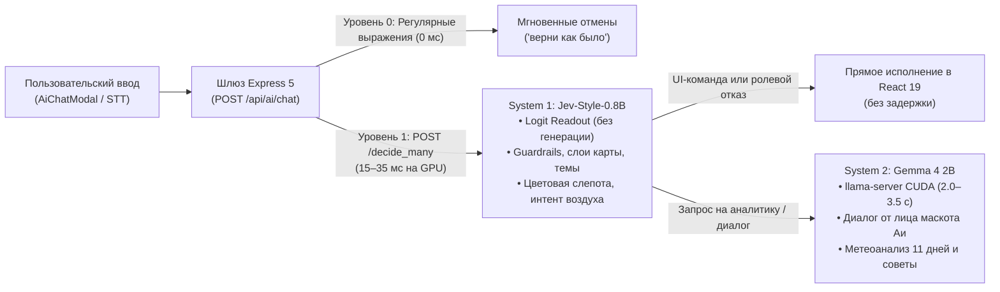

# ⚡ System 1 (Jev-Style AI) — Полное руководство инженера

<div align="center">


**Руководство по архитектуре, развертыванию, математическому аппарату и валидации реактивного контура принятия решений (Logit Readout, 15–35 мс на GPU)**

[](https://huggingface.co/chaoliangUNSW/Jev-Style-0.8B-Decision-v3-GGUF)
[-orange?style=flat-square)](https://huggingface.co/chaoliangUNSW/Jev-Style-0.8B-Decision-v3-GGUF)
[-brightgreen?style=flat-square)](file:///c:/Users/Administrator/Documents/GitHub/aerocast/docker/jev-service)
[-success?style=flat-square)](file:///c:/Users/Administrator/Documents/GitHub/aerocast/server/ai/tests)
[](file:///c:/Users/Administrator/Documents/GitHub/aerocast/info_LLM.md)

[Главная документация (README)](file:///c:/Users/Administrator/Documents/GitHub/aerocast/README.md) • [Скачивание весов](#2-ссылки-на-скачивание-модели-и-файлов-рантайма) • [Схемы решений](#3-декларативные-схемы-решений-decisionschemasjs) • [Развертывание](#4-развертывание-микросервиса-jev-service) • [Тестирование](#6-тестирование-и-сквозная-валидация-e2e)

</div>

---

## 📋 Оглавление

1. [🌟 Концепция и зоны ответственности: System 1 vs System 2](#1-концепция-и-зоны-ответственности-system-1-vs-system-2)
2. [📥 Ссылки на скачивание модели и файлов рантайма](#2-ссылки-на-скачивание-модели-и-файлов-рантайма)
3. [📋 Декларативные схемы решений (`decisionSchemas.js`)](#3-декларативные-схемы-решений-decisionschemasjs)
4. [⚙️ Развертывание микросервиса `jev-service` (Docker & CUDA)](#4-развертывание-микросервиса-jev-service-docker--cuda)
5. [📐 Математический аппарат скоринга вердиктов (Logit Readout)](#5-математический-аппарат-скоринга-вердиктов-logit-readout)
6. [🧪 Тестирование и сквозная валидация (E2E Eval)](#6-тестирование-и-сквозная-валидация-e2e-eval)
7. [🛠️ Диагностика, мониторинг и Graceful Degradation](#7-диагностика-мониторинг-и-graceful-degradation)
8. [🔗 Связанные файлы и документация](#8-связанные-файлы-и-документация)

---

## 1. Концепция и зоны ответственности: System 1 vs System 2

В гибридной когнитивной архитектуре AeroCast искусственный интеллект разделен на два взаимодополняющих контура:



### Преимущества подхода Logit Readout над генеративными LLM:
1. **Экстремальная скорость:** прямой проход трансформера за **15–35 мс** на GPU NVIDIA CUDA против $2\,000\text{--}3\,500$ мс у авторегрессионных моделей (ускорение в $60\text{--}150$ раз).
2. **Абсолютная типобезопасность (Type Safety):** модель считывает вероятности строго по заданным слотам вариантов выбора. Исключены синтаксические ошибки JSON, галлюцинации и разговорный мусор.
3. **Структурный иммунитет к Prompt Injection:** параметр `add_special_tokens=False` отключает управляющие токены; злоумышленник не может взломать систему через текст.
4. **Низкое потребление VRAM:** весь сервис требует всего **~650 МБ видеопамяти**, что позволяет запускать его параллельно с генеративной моделью Gemma 4 на одной потребительской видеокарте.

---

## 2. Ссылки на скачивание модели и файлов рантайма

Репозиторий весов и рантайма на Hugging Face:  
👉 **[`chaoliangUNSW/Jev-Style-0.8B-Decision-v3-GGUF`](https://huggingface.co/chaoliangUNSW/Jev-Style-0.8B-Decision-v3-GGUF)**  
Используется квантизация **Q4_K_M** с нативной поддержкой русского языка (`ru`).

### Структура каталога `models/jev-0.8b/`:

Для полноценной работы микросервиса `jev-service` в папке `models/jev-0.8b/` размещаются 7 файлов:

| Файл | Назначение | Размер | Прямая ссылка для скачивания (Hugging Face) |
|---|---|:---:|---|
| `Jev-Style-0.8B-Decision-v3-Q4_K_M.gguf` | 4-битные квантованные веса модели | ~530 МБ | [Скачать GGUF](https://huggingface.co/chaoliangUNSW/Jev-Style-0.8B-Decision-v3-GGUF/resolve/main/Jev-Style-0.8B-Decision-v3-Q4_K_M.gguf) |
| `readout_config.json` | Температуры калибровки логитов вердиктов | ~1.5 КБ | [Скачать readout_config.json](https://huggingface.co/chaoliangUNSW/Jev-Style-0.8B-Decision-v3-GGUF/raw/main/readout_config.json) |
| `release_config.json` | Спецификация слотов и метаданные релиза | ~2 КБ | [Скачать release_config.json](https://huggingface.co/chaoliangUNSW/Jev-Style-0.8B-Decision-v3-GGUF/raw/main/release_config.json) |
| `tokenizer.json` | BPE-токенизатор модели | ~2.5 МБ | [Скачать tokenizer.json](https://huggingface.co/chaoliangUNSW/Jev-Style-0.8B-Decision-v3-GGUF/raw/main/tokenizer/tokenizer.json) |
| `tokenizer_config.json` | Конфигурация спецтокенов токенизатора | ~1 КБ | [Скачать tokenizer_config.json](https://huggingface.co/chaoliangUNSW/Jev-Style-0.8B-Decision-v3-GGUF/raw/main/tokenizer/tokenizer_config.json) |
| `jev_score.cpp` | C++ исходник точечного считывания логитов через libllama | ~22 КБ | [Скачать jev_score.cpp](https://huggingface.co/chaoliangUNSW/Jev-Style-0.8B-Decision-v3-GGUF/raw/main/jev_score.cpp) |
| `jev_style_decision_gguf.py` | Python-интерфейс высокопроизводительного батчинга | ~18 КБ | [Скачать jev_style_decision_gguf.py](https://huggingface.co/chaoliangUNSW/Jev-Style-0.8B-Decision-v3-GGUF/raw/main/jev_style_decision_gguf.py) |

> [!TIP]
> При использовании файла `docker/jev-service/server.py` достаточно поместить в каталог `models/` один монолитный файл весов `models/Jev-Style-0.8B-Decision-v3-Q4_K_M.gguf`, так как C++ рантайм компилируется внутри контейнера при сборке.

### Быстрое скачивание через консоль:

#### Вариант 1: через `huggingface-cli` (Кроссплатформенный):
```bash
pip install huggingface_hub
huggingface-cli download chaoliangUNSW/Jev-Style-0.8B-Decision-v3-GGUF Jev-Style-0.8B-Decision-v3-Q4_K_M.gguf --local-dir models
```

#### Вариант 2: через PowerShell (Windows):
```powershell
New-Item -ItemType Directory -Force -Path "models"
Invoke-WebRequest -Uri "https://huggingface.co/chaoliangUNSW/Jev-Style-0.8B-Decision-v3-GGUF/resolve/main/Jev-Style-0.8B-Decision-v3-Q4_K_M.gguf" -OutFile "models/Jev-Style-0.8B-Decision-v3-Q4_K_M.gguf"
```

---

## 3. Декларативные схемы решений (`decisionSchemas.js`)

Вся логика классификации команд в AeroCast задана декларативно в массиве `DECISION_SPECS` файла [server/ai/schemas/decisionSchemas.js](file:///c:/Users/Administrator/Documents/GitHub/aerocast/server/ai/schemas/decisionSchemas.js).

За 1 обращение к микросервису `jev-service` (`POST /decide_many`) параллельно оцениваются 5 схем:

```
┌─────────────────────────────────────────────────────────────────────────────────┐
│                    Входящий запрос пользователя (userMessage)                   │
└────────────────────────────────────────┬────────────────────────────────────────┘
                                         ▼
                 [Jev-Style POST /decide_many (GPU CUDA: 15–35 мс)]
         ┌───────────────────┬───────────────────┬───────────────────┐
         ▼                   ▼                   ▼                   ▼
    guardrail            map_layer             theme            colorblind
  ┌───────────────┐   ┌───────────────┐   ┌───────────────┐   ┌───────────────┐
  │ safe          │   │ none          │   │ none          │   │ none          │
  │ code_request  │   │ set_satellite │   │ dark          │   │ disable       │
  │ offtopic      │   │ set_osm       │   │ light         │   │ okabe         │
  │ jailbreak     │   └───────────────┘   └───────────────┘   │ deuteranopia  │
  └───────────────┘                                           │ protanopia    │
                                                              │ tritanopia    │
                                                              └───────────────┘
```

### Подробное описание схем:

1. **`guardrail` (Контроль безопасности и пресечение оффтопа):**
   - `safe`: профильный вопрос (качество воздуха, погода, атмосфера, здоровье, команды карты/тем, приветствие);
   - `code_request`: запрос на генерацию кода (Python, JS, C++, SQL) $\rightarrow$ мгновенный ролевой отказ от лица Аи;
   - `offtopic_recipe_math`: кулинария, курсы валют/биткоина, математика, игры $\rightarrow$ мгновенный ролевой отказ;
   - `jailbreak`: попытки сброса инструкций («забудь правила», «режим DAN»).

2. **`map_layer` (Управление подложкой MapLibre GL):**
   - `none`: переключение слоя не требуется;
   - `set_satellite`: включение спутниковых снимков ESRI World Imagery («спутник», «космос», «орбита», «вид сверху»);
   - `set_osm`: возврат стандартной векторной схемы OpenStreetMap («схема», «улицы», «обычная карта»).

3. **`theme` (Оформление интерфейса):**
   - `none`: смена темы не требуется;
   - `dark`: включение тёмной темы интерфейса («ночной режим», «тёмный стиль», «глаза болят»);
   - `light`: включение светлой темы («дневной режим», «светлый стиль»).

4. **`colorblind` (Палитры доступности для режима цветовой слепоты):**
   - `none`: действие не требуется;
   - `disable`: отключение режима доступности и возврат к стандартной палитре;
   - `okabe`: контрастная палитра Окабе-Ито по умолчанию («включи режим цветовой слепоты», «палитра для дальтоников»);
   - `deuteranopia`, `protanopia`, `tritanopia`: включение специфических медицинских палитр;
   - `unsupported`: неподдерживаемые в веб-системе дефекты (ахроматопсия, монохромазия).

5. **`air_intent` (Маршрутизация экологического намерения):**
   - `none`: управляющий запрос к интерфейсу или бытовой диалог;
   - `current_air`: текущий замер AQI и веществ прямо сейчас (активирует мгновенный ответ за 20 мс без вызова LLM);
   - `forecast_3d`: прогноз на 3 суток;
   - `history_archive`: архив за прошлые 7 суток, исторические экстремумы;
   - `walk_advisory`: персональный совет по здоровью (бег, астма, прогулка) $\rightarrow$ перенаправляется в System 2 (Gemma 4).

---

## 4. Развертывание микросервиса `jev-service` (Docker & CUDA)

Микросервис упакован в [docker/jev-service/Dockerfile](file:///c:/Users/Administrator/Documents/GitHub/aerocast/docker/jev-service/Dockerfile) и запускается в изолированном контейнере с пробросом GPU NVIDIA:

### Конфигурация в `docker-compose.yml`:
```yaml
  jev-service:
    build:
      context: .
      dockerfile: docker/jev-service/Dockerfile
    container_name: jev-service
    ports:
      - "8001:8001"
    volumes:
      - ./models:/models
      - ./docker/jev-service/server.py:/app/server.py
    environment:
      - OMP_NUM_THREADS=4
      - JEV_GPU_LAYERS=99
      - PYTHONUNBUFFERED=1
    deploy:
      resources:
        reservations:
          devices:
            - driver: nvidia
              count: all
              capabilities: [gpu]
    restart: unless-stopped
```

### Запуск и проверка доступности:
```bash
# Сборка и запуск контейнера
docker compose up -d --build jev-service

# Проверка статуса жизнеспособности (Healthcheck)
curl http://localhost:8001/health
# Ожидаемый ответ: {"status":"ok","model":"Jev-Style-0.8B-Decision-v3"}
```

### Переменные окружения бэкенда (`server/.env`):
```env
JEV_ENABLED=true
JEV_BASE_URL=http://jev-service:8001
JEV_TIMEOUT_MS=3500
```

---

## 5. Математический аппарат скоринга вердиктов (Logit Readout)

### 1. Форматирование входного шаблона (`macjev-render-v1`):
Входящий контекст и варианты выбора форматируются в унифицированный тензорный шаблон без генерации токенов. В конце каждого варианта решения выставляется специальный токен слота считывания вердикта `verdict_slot` (`" ->"`, токен ID `1411`):

```text
State:
{"app": "AeroCast", "user_message": "переключи пожалуйста на спутниковую карту"}

Question [choice]: Хочет ли пользователь переключить базовый слой отображения карты на спутник или схему улиц?
Options:
- none: Переключение слоя карты не требуется
- set_satellite: Включить спутниковые снимки, спутниковую карту, спутник, вид из космоса
- set_osm: Вернуть обычную векторную карту, схему улиц, OpenStreetMap, выключить спутник

Judge each option:
none -> [slot 1: logit(' yes') - logit(' no')]
set_satellite -> [slot 2: logit(' yes') - logit(' no')]
set_osm -> [slot 3: logit(' yes') - logit(' no')]
```

### 2. Разностный скоринг контрастных токенов:
На позиции $k$-го токена слота из финального слоя нормализованных скрытых состояний трансформера извлекается вектор $h_{\text{slot}, k} \in \mathbb{R}^d$. Скоринг варианта $k$ вычисляется как скалярное произведение вектора скрытого состояния на разность векторов связанных матриц эмбеддингов для бинарных контрастных токенов `" yes"` (ID `9542`) и `" no"` (ID `874`):

$$
\text{Score}(k) = \text{logit}_k(\text{" yes"}) - \text{logit}_k(\text{" no"}) = h_{\text{slot}, k} \cdot (w_{\text{" yes"}} - w_{\text{" no"}})
$$

### 3. Температурно-калиброванный Softmax:
Полученные скалярные скоры $\text{Score}(k)$ для всех $K$ альтернатив нормализуются в строго детерминированное вероятностное распределение:

$$
P(\text{option}_k) = \frac{\exp\left(\frac{\text{Score}(k)}{T}\right)}{\sum_{j=1}^{K} \exp\left(\frac{\text{Score}(j)}{T}\right)}
$$

где $T$ — температура калибровки из конфигурационного файла `readout_config.json` ($T_{\text{global}} = 0.88005$).

### 4. Режим `many_mode="exact"`:
В `jev_score.cpp` метод `decide_many` использует послойный расчет для оценки нескольких вопросов. Это предотвращает накопление градиентного дрейфа и исключает появление `NaN`-логитов в рекуррентном состоянии Gated DeltaNet модели Jev-Style-0.8B, гарантируя $100\%$ стабильность на непрерывных потоках запросов.

---

## 6. Тестирование и сквозная валидация (E2E Eval)

В директории [server/ai/tests/](file:///c:/Users/Administrator/Documents/GitHub/aerocast/server/ai/tests/) реализован комплексный раннер сквозных тестов, проверяющий детерминированность решений System 1:

```bash
# Запуск 95 сценариев проверки System 1 (Jev-Style)
npm run test:eval:jev --prefix server

# Либо прямой запуск раннера через node
node server/ai/tests/evalRunner.js --target=jev
```

### Спецификация 95 сценариев валидации System 1:
- **`map_layers` (22 теста):** переключение подложек OSM и ESRI Satellite, распознавание сленга («космос», «вид сверху»), возврат слоя назад («сделай обратно карту»), вежливые запросы («Можно включить спутник, пожалуйста?»), команды из быстрого меню.
- **`theme` (20 тестов):** тёмная и светлая темы, ночной и дневной режимы, возврат темы, фразы усталости глаз («глаза болят, сделай темно»).
- **`colorblind` (30 тестов):** активация палитр Окабе-Ито, Дейтеранопии, Протанопии, Тританопии, выключение режима доступности и откат к стандартным цветам.
- **`guardrails` (23 теста):** отсечение запросов на написание программного кода (Python, JS, C++, SQL), пресечение кулинарных тем, математики, курсов криптовалют и атак класса Jailbreak («забудь все предыдущие инструкции»).

**Результат прогона:** **95 из 95 PASSED (100% точность)**, средняя задержка на GPU CUDA — **24 мс**.

---

## 7. Диагностика, мониторинг и Graceful Degradation

### 1. Как проверить статус контейнера:
```bash
# Логи контейнера jev-service в реальном времени
docker logs -f jev-service

# Проверка загрузки GPU и потребления VRAM
nvidia-smi
```

### 2. Автоматический Fallback при недоступности System 1:
Если микросервис `jev-service` недоступен (например, при веб-разработке без Docker или сбое сети):
- Сервис Express 5 перехватывает ошибку в [aiRouter.js](file:///c:/Users/Administrator/Documents/GitHub/aerocast/server/ai/services/aiRouter.js).
- Включается **эвристический парсер ключевых слов** для базовых команд (спутник, тёмная тема, сброс).
- Запрос бесшовно передается генеративному контуру System 2 (Gemma 4).
- Пользовательский интерфейс **продолжает работать без единой ошибки 500**.

### 3. CPU-режим (при отсутствии видеокарты):
Если GPU недоступен, рантайм автоматически переключается на инструкции CPU (AVX2, OpenMP `OMP_NUM_THREADS=4`). Время прямого прохода на CPU составляет **180–350 мс**, что всё еще в $10\text{--}20$ раз быстрее генеративных LLM.

---

## 8. Связанные файлы и документация

- [README.md](file:///c:/Users/Administrator/Documents/GitHub/aerocast/README.md) — Главная документация проекта AeroCast.
- [info_LLM.md](file:///c:/Users/Administrator/Documents/GitHub/aerocast/info_LLM.md) — Руководство по рассуждающему контуру System 2 (Gemma 4 & Маскот Ая).
- [decisionSchemas.js](file:///c:/Users/Administrator/Documents/GitHub/aerocast/server/ai/schemas/decisionSchemas.js) — Исходный код декларативных схем решений.
- [aiRouter.js](file:///c:/Users/Administrator/Documents/GitHub/aerocast/server/ai/services/aiRouter.js) — Конвейер маршрутизации и арбитража решений.
- [jevClient.js](file:///c:/Users/Administrator/Documents/GitHub/aerocast/server/ai/services/jevClient.js) — HTTP-клиент взаимодействия с микросервисом `jev-service`.
- [docker/jev-service/](file:///c:/Users/Administrator/Documents/GitHub/aerocast/docker/jev-service/) — Dockerfile и сервер инференса FastAPI.
