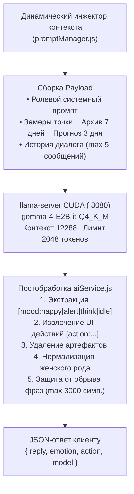

# 🧠 System 2 (Gemma 4 & Маскот Ая) — Полное руководство инженера

<div align="center">


**Руководство по архитектуре, развертыванию, инженерии промптов и валидации генеративного рассуждающего контура (Маскот Ая, метеоанализ 11 дней, Two-Step навигация)**

[](https://huggingface.co/lmstudio-community/gemma-4-E2B-it-GGUF)
[-orange?style=flat-square)](https://huggingface.co/lmstudio-community/gemma-4-E2B-it-GGUF)
[](file:///c:/Users/Administrator/Documents/GitHub/aerocast/docker-compose.yml)
[](file:///c:/Users/Administrator/Documents/GitHub/aerocast/server/ai/config/aiConfig.js)
[-success?style=flat-square)](file:///c:/Users/Administrator/Documents/GitHub/aerocast/server/ai/tests)
[](file:///c:/Users/Administrator/Documents/GitHub/aerocast/info_JEV.md)

[Главная документация (README)](file:///c:/Users/Administrator/Documents/GitHub/aerocast/README.md) • [Скачивание весов](#2-ссылки-на-скачивание-модели) • [Инженерия промптов](#3-инженерия-динамического-контекста-promptmanagerjs) • [Развертывание](#4-контейнеризация-и-развертывание-llama-server) • [Тестирование](#6-тестирование-и-сквозная-валидация-e2e)

</div>

---

## 📋 Оглавление

1. [🌟 Роль и концепция System 2 в AeroCast](#1-роль-и-концепция-system-2-в-aerocast)
2. [📥 Ссылки на скачивание модели](#2-ссылки-на-скачивание-модели)
3. [📝 Инженерия динамического контекста (`promptManager.js`)](#3-инженерия-динамического-контекста-promptmanagerjs)
4. [🐳 Контейнеризация и развертывание (`llama-server`)](#4-контейнеризация-и-развертывание-llama-server)
5. [🔄 Двухэтапный протокол аналитики (Two-Step Flow)](#5-двухэтапный-протокол-аналитики-two-step-flow)
6. [🧪 Тестирование и сквозная валидация (E2E Eval)](#6-тестирование-и-сквозная-валидация-e2e-eval)
7. [🛡️ Конвейер постобработки и отказоустойчивость (`aiService.js`)](#7-конвейер-постобработки-и-отказоустойчивость-aiservicejs)
8. [🛠️ Диагностика и устранение неполадок (FAQ)](#8-диагностика-и-устранение-неполадок-troubleshooting--faq)
9. [🔗 Связанные файлы и документация](#9-связанные-файлы-и-документация)

---

## 1. Роль и концепция System 2 в AeroCast

В гибридной двухконтурной архитектуре AeroCast модель **Gemma 4** выполняет функции когнитивного уровня **System 2** («медленное, глубокое рассуждающее мышление»).

В то время как реактивный классификатор System 1 ([info_JEV.md](file:///c:/Users/Administrator/Documents/GitHub/aerocast/info_JEV.md)) за 15–35 мс выполняет мгновенный арбитраж интерфейсных команд (слои карты, темы оформления, фильтрация оффтопа), System 2 ориентирована на сложные творческие и аналитические задачи:



### Ключевые зоны ответственности System 2:
1. **Персонализированный экспертный эко-диалог:** общение от лица официального маскота платформы — девушки **Аи** с эмоциональным характером заботливой цундере (*«хмпф!», «ня!», «бака!»*). Создатель и ведущий разработчик платформы: **Николаев Артём Дмитриевич**.
2. **Комплексная метеоаналитика 11 дней:** интерпретация текущих замеров (индекс EAQI, 6 веществ: $PM_{2.5}, PM_{10}, NO_2, SO_2, O_3, CO$, пыль, УФ-индекс), ретроспективного 7-дневного архива с выявлением исторических пиков и 3-дневного почасового прогноза.
3. **Медицинские и превентивные рекомендации:** советы по активности на открытом воздухе (прогулки, интенсивный бег, проветривание) для здоровых людей и уязвимых категорий (астматики, аллергики, дети, пожилые люди).
4. **Интеллектуальная навигация по карте:** выделение намерений перемещения к удаленным городам с генерацией структурированных действий `[action:set_location:НазваниеГорода]`.
5. **Динамическое эмоциональное сопровождение:** разметка эмоционального состояния Аи в начале каждого ответа служебными тегами `[mood:happy]`, `[mood:alert]`, `[mood:think]` или `[mood:idle]` для управления Live2D-моделью в браузере.

---

## 2. Ссылки для скачивания модели

Модель распространяется в формате **GGUF v3** с квантизацией **Q4_K_M** (оптимальный баланс между скоростью генерации, потреблением памяти и сохранением русскоязычной грамматики).

* **Репозиторий на Hugging Face:** [`lmstudio-community/gemma-4-E2B-it-GGUF`](https://huggingface.co/lmstudio-community/gemma-4-E2B-it-GGUF)
* **Прямая ссылка на файл весов:**  
  👉 **[Скачать gemma-4-E2B-it-Q4_K_M.gguf (~1.8 ГБ)](https://huggingface.co/lmstudio-community/gemma-4-E2B-it-GGUF/resolve/main/gemma-4-E2B-it-Q4_K_M.gguf?download=true)**

### Размещение файла в структуре проекта:
Файл модели должен быть сохранен строго по пути:
```
aerocast/
└── models/
    └── gemma-4-E2B-it-Q4_K_M.gguf
```

### Команды скачивания через консоль:

#### Вариант 1: через `huggingface-cli` (Кроссплатформенный):
```bash
pip install huggingface_hub
huggingface-cli download lmstudio-community/gemma-4-E2B-it-GGUF gemma-4-E2B-it-Q4_K_M.gguf --local-dir models
```

#### Вариант 2: через PowerShell (Windows):
```powershell
New-Item -ItemType Directory -Force -Path "models"
Invoke-WebRequest -Uri "https://huggingface.co/lmstudio-community/gemma-4-E2B-it-GGUF/resolve/main/gemma-4-E2B-it-Q4_K_M.gguf?download=true" -OutFile "models/gemma-4-E2B-it-Q4_K_M.gguf"
```

> [!NOTE]
> При ограничении прямого доступа к серверам Hugging Face используйте официальное зеркало (например, `https://hf-mirror.com`).

---

## 3. Инженерия динамического контекста (`promptManager.js`)

Системный промпт собирается динамически в модуле [server/ai/services/promptManager.js](file:///c:/Users/Administrator/Documents/GitHub/aerocast/server/ai/services/promptManager.js) в момент поступления пользовательского запроса:

```
┌────────────────────────────────────────────────────────────────────────┐
│                   СТАТИЧЕСКОЕ РОЛЕВОЕ ЯДРО (Persona Core)              │
│ • Персонаж: Девушка-маскот чистого воздуха Ая (заботливая цундере)     │
│ • Грамматика: Строго женский род («я сама проверила», «готова помочь») │
│ • Создатель и автор платформы: Николаев Артём Дмитриевич                │
│ • Запреты: отказ от программирования, запрет упоминания отсечки знаний │
└───────────────────────────────────┬────────────────────────────────────┘
                                    │
                                    ▼
┌────────────────────────────────────────────────────────────────────────┐
│             ДИНАМИЧЕСКИЙ МЕТЕОРОЛОГИЧЕСКИЙ КОНТЕКСТ ТОЧКИ              │
│ 1. Текущий срез: Координаты, город, EAQI, 6 газов, пыль, УФ-индекс     │
│ 2. Архив 7 суток: Точный пик (значение, дата, время), минимум, среднее │
│ 3. Прогноз 3 суток: Средний индекс, диапазон колебаний, тренд по дням  │
│ 4. Сводный интеграл: Средний показатель за все 11 суток                │
└───────────────────────────────────┬────────────────────────────────────┘
                                    │
                                    ▼
┌────────────────────────────────────────────────────────────────────────┐
│           СТРУКТУРИРОВАННЫЙ 4-БЛОЧНЫЙ ФОРМАТ ОТВЕТА (Output Spec)      │
│ 1. Статус и индекс (EAQI + вербальная категория)                       │
│ 2. Загрязнение и вещества (PM2.5, PM10, газы в сравнении с ВОЗ)        │
│ 3. Динамика, архив и прогноз (точный пик с временем, суточный тренд)   │
│ 4. Практические рекомендации (прогулки, спорт, дети, астматики)        │
└────────────────────────────────────────────────────────────────────────┘
```

### Защита от обрыва фраз (Sentence Boundary Limiting):
Для исключения незавершенных мыслей в [aiService.js](file:///c:/Users/Administrator/Documents/GitHub/aerocast/server/ai/services/aiService.js) внедрен многоступенчатый фильтр:
- Текст обрезается строго по границе последнего законченного предложения (`.`, `!`, `?`).
- Висячие двоеточия (например: *«в 04:»*), запятые и союзы автоматически зачищаются с откатом к предыдущему предложению.
- Максимальный объем ответа ограничен параметром `LLM_MAX_CHAR_LIMIT=3000` символов.

---

## 4. Контейнеризация и развертывание (`llama-server`)

Инференс модели выполняется в официальном образе `ghcr.io/ggml-org/llama.cpp:server-cuda` с прямой трансляцией инструкций на графический процессор:

### Конфигурация в `docker-compose.yml`:
```yaml
  llama-server:
    image: ghcr.io/ggml-org/llama.cpp:server-cuda
    container_name: llama-server
    restart: unless-stopped
    ports:
      - "8080:8080"
    volumes:
      - ./models:/models
    command: >
      -m /models/gemma-4-E2B-it-Q4_K_M.gguf
      --host 0.0.0.0
      --port 8080
      -ngl 99
      --ctx-size 12288
      -n 2048
      -np 1
      --no-cache-prompt
      --slot-prompt-similarity 0.0
      --no-context-shift
      --repeat-penalty 1.1
    deploy:
      resources:
        reservations:
          devices:
            - driver: nvidia
              count: 1
              capabilities: [gpu]
```

### Анализ ключевых флагов запуска:
- `-ngl 99` (*number of GPU layers*) — выгрузка всех 35 слоев модели в память видеокарты, снижающая задержку генерации токена до $12\text{--}18$ мс.
- `--ctx-size 12288` — расширенное контекстное окно, вмещающее весь 11-дневный массив замеров, историю переписки и структурированные аналитические отчеты.
- `-n 2048` — предел генерации до 2048 токенов (устраняет стандартное ограничение llama.cpp в 256 токенов).
- `-np 1` — ограничение параллельных слотов до 1, экономящее видеопамять и исключающее ошибки `illegal memory access` в `mmq.cu:280`.
- `--no-cache-prompt` и `--slot-prompt-similarity 0.0` — отключение межзапросного кэширования префикса в KV-кэше, предотвращающее дрейф указателей при длинных тестовых прогонах.
- `--no-context-shift` — строгий запрет автосдвига контекста.

### Переменные окружения бэкенда (`server/.env`):
```env
LLM_BASE_URL=http://llama-server:8080/v1
LLM_API_KEY=not-needed
LLM_MODEL=gemma-4-E2B-it-Q4_K_M
LLM_MAX_TOKENS=2048
LLM_TEMPERATURE=0.8
LLM_TOP_P=0.9
LLM_REPEAT_PENALTY=1.08
LLM_FREQUENCY_PENALTY=0.15
LLM_PRESENCE_PENALTY=0.15
LLM_TIMEOUT_MS=75000
LLM_MAX_HISTORY=5
LLM_MAX_CHAR_LIMIT=3000
```

---

## 5. Двухэтапный протокол аналитики (Two-Step Flow)

Когда пользователь запрашивает экологическую обстановку по городу, который в данный момент не отображается на карте (например, находясь в Москве, пишет: *«покажи замеры по Новосибирску»*), активируется двухэтапный сценарий:

```
[Пользователь] ── "Что с воздухом в Новосибирске?" ──> [Express Gateway]
                                                              │
 ┌────────────────────────────────────────────────────────────┘
 │ Шаг 1: Распознавание города через геокодер (Open-Meteo)
 ▼
[Ответ клиенту] ── action: { type: 'set_location', cityName: 'Новосибирск', followUpAnalytics: true }
                ── reply: "Секундочку! Перемещаемся в Новосибирск, смотрю свежие замеры воздуха, ня! ✨"
                ── emotion: "think"
 │
 └─> [React Client] ── 1. Плавное центрирование камеры MapLibre GL на Новосибирске
                    ── 2. Параллельный запрос свежих замеров через /api/air
                    ── 3. Автоматический фоновый запрос с { isFollowUpAnalytics: true, pointAnalytics }
                         │
 ┌───────────────────────┘
 ▼
[Шаг 2: System 2 Gemma 4] ── Формирует исчерпывающий 4-блочный отчет на основе реальных замеров
```

Этот подход исключает галлюцинации языковой модели и гарантирует, что пользователь видит только фактические данные замеров.

---

## 6. Тестирование и сквозная валидация (E2E Eval)

Для подтверждения соответствия роли маскота, отсутствия сбоев синтаксиса и точности метеоанализа разработан раннер сквозных сценариев [server/ai/tests/evalRunner.js](file:///c:/Users/Administrator/Documents/GitHub/aerocast/server/ai/tests/evalRunner.js):

```bash
# Запуск всех 160 сценариев валидации System 2 (Gemma 4)
npm run test:eval:gemma --prefix server

# Запуск полного сквозного набора двухконтурного ИИ (255 сценариев: Jev + Gemma)
npm run test:eval --prefix server
```

### Спецификация 160 сценариев верификации System 2:
- **`map_layers_qa` (8 тестов):** ответы на вопросы о картографических слоях (отличия схемы OpenStreetMap от спутниковых снимков ESRI).
- **`colorblind_qa` (8 тестов):** консультация по палитрам доступности (Окабе-Ито, Дейтеранопия, Протанопия, Тританопия).
- **`app_knowledge` (21 тест):** знания о возможностях платформы AeroCast, нормативах ВОЗ, шкале EAQI, загрязнителях ($PM_{2.5}, PM_{10}, NO_2, SO_2, O_3, CO$).
- **`persona_grammar` (16 тестов):** строгое соблюдение женского рода маскота Аи («сама проверила», «рада помочь»), характер цундере, указание автора Николаева Артёма Дмитриевича.
- **`navigation` (36 тестов):** навигация по городам России и мира с генерацией действий `[action:set_location:Город]` и фильтрацией ложных запросов («точка», «тачка»).
- **`analytics` (71 тест):** глубокий ситуационный анализ замеров воздуха для групп риска (астматики, дети, пожилые люди), точный исторический пик в архиве с указанием дня и времени, предиктивный прогноз на 3 дня.

**Результат прогона:** **160 из 160 PASSED (100% точность)**.

---

## 7. Конвейер постобработки и отказоустойчивость (`aiService.js`)

Сгенерированный моделью текст проходит детерминированную многоуровневую фильтрацию в [server/ai/services/aiService.js](file:///c:/Users/Administrator/Documents/GitHub/aerocast/server/ai/services/aiService.js):

1. **Экстракция настроения:** извлечение тегов `[mood:happy|alert|think|idle]`. Если уровень EAQI > 80, статус автоматически корректируется на `think` или `alert`.
2. **Парсинг команд UI:** выделение директив `[action:set_location:Город]`, валидация через геокодер `resolveCity` и передача в объект ответа.
3. **Очистка артефактов Chain-of-Thought:** вырезание скрытых служебных тегов `<think>...</think>`.
4. **Фильтрация CJK-токенов:** автоматическая замена китайских символов диапазона `[\u4e00-\u9fff]` на русскоязычные эквиваленты.
5. **Нормализация женского рода:** функции `fixFeminineGrammar` заменяют ошибочные формы мужского рода («я заметил» $\rightarrow$ «я заметила»).
6. **Дедупликация предложений:** защита от авторегрессионного зацикливания через хеширование предложений длиннее 5 символов.
7. **Трехуровневый Graceful Degradation:**
   - *Уровень 1:* штатный GPU-инференс через `llama-server` (2.0–3.5 с).
   - *Уровень 2:* аппаратный CPU-fallback (4–7 с).
   - *Уровень 3:* встроенный оффлайн-генератор шаблонов (`generatePointAnalyticsReply`, `generateForecastReply`). Пользователь получает корректный расчет параметров воздуха даже при полном падении контейнера нейросети!

---

## 8. Диагностика и устранение неполадок (FAQ)

### 1. Ошибка `Connection refused` на порту 8080:
- **Причина:** контейнер `llama-server` не запущен или упал при инициализации.
- **Решение:** проверьте логи `docker logs llama-server`. Убедитесь, что файл `models/gemma-4-E2B-it-Q4_K_M.gguf` скачан полностью (~1.8 ГБ) и не поврежден.

### 2. Ошибка CUDA `out of memory`:
- **Причина:** видеокарта имеет менее 4 ГБ доступной VRAM.
- **Решение:** в [docker-compose.yml](file:///c:/Users/Administrator/Documents/GitHub/aerocast/docker-compose.yml) уменьшите число GPU-слоев (например, с `-ngl 99` до `-ngl 24`) или размер контекстного окна (`--ctx-size 4096`).

### 3. Запуск без дискретной видеокарты (CPU-режим):
- В файле [docker-compose.yml](file:///c:/Users/Administrator/Documents/GitHub/aerocast/docker-compose.yml) замените образ `ghcr.io/ggml-org/llama.cpp:server-cuda` на `ghcr.io/ggml-org/llama.cpp:server` и удалите секцию `deploy.resources`. Модель будет генерировать ответы на потоках центрального процессора.

---

## 9. Связанные файлы и документация

- [README.md](file:///c:/Users/Administrator/Documents/GitHub/aerocast/README.md) — Главная документация проекта AeroCast.
- [info_JEV.md](file:///c:/Users/Administrator/Documents/GitHub/aerocast/info_JEV.md) — Руководство по реактивному контуру System 1 (Jev-Style).
- [promptManager.js](file:///c:/Users/Administrator/Documents/GitHub/aerocast/server/ai/services/promptManager.js) — Генерация ролевого и динамического контекста.
- [aiService.js](file:///c:/Users/Administrator/Documents/GitHub/aerocast/server/ai/services/aiService.js) — Интеграция с OpenAI API, валидация и фильтрация.
- [aiConfig.js](file:///c:/Users/Administrator/Documents/GitHub/aerocast/server/ai/config/aiConfig.js) — Параметры температуры, штрафов и контекста.
- [docker-compose.yml](file:///c:/Users/Administrator/Documents/GitHub/aerocast/docker-compose.yml) — Оркестрация сервиса `llama-server`.
